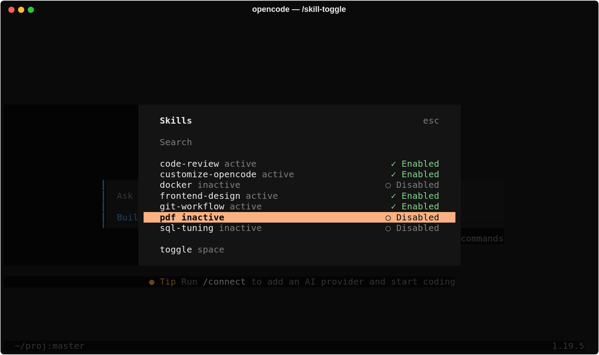
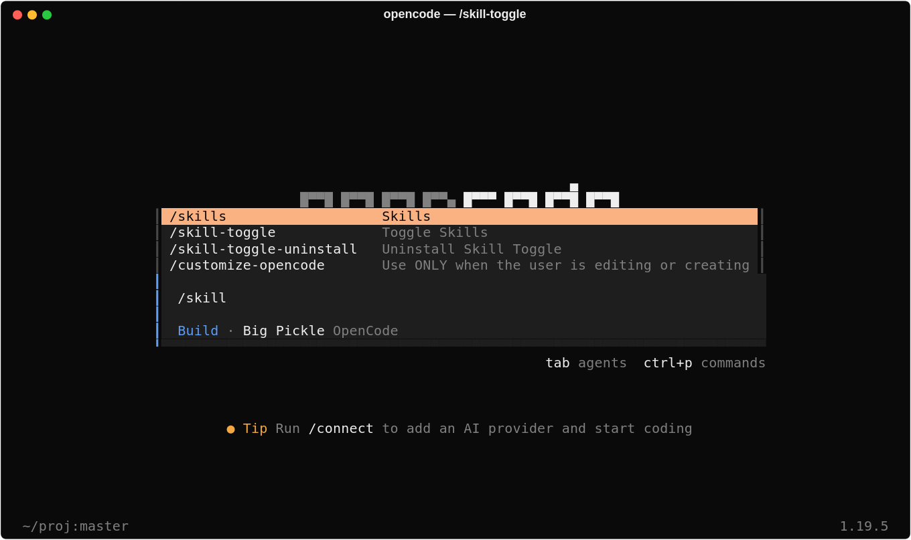
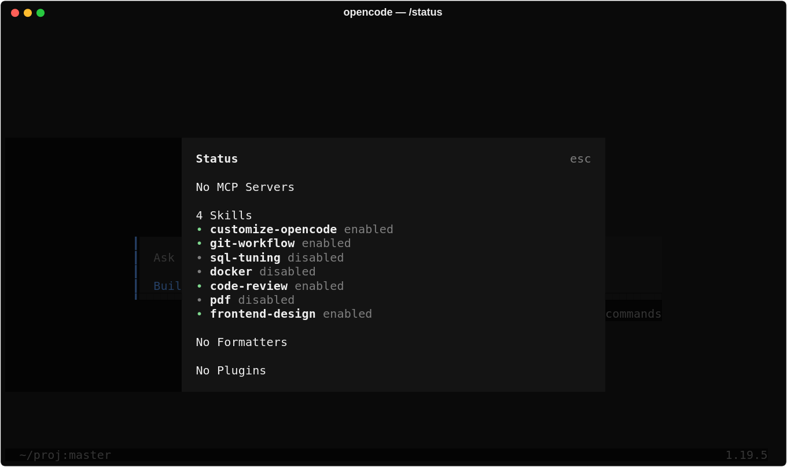
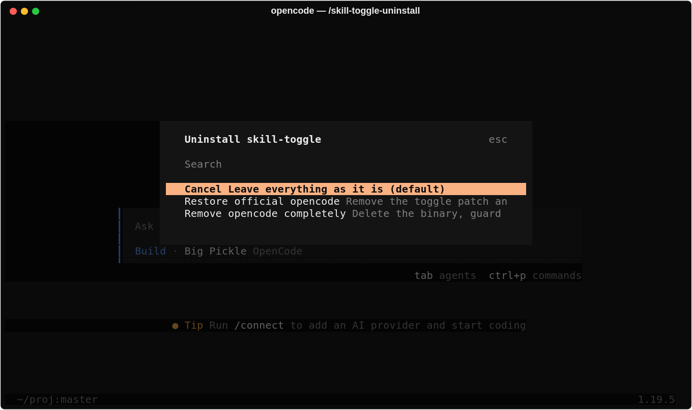

# ✨ opencode-skill-toggle


> 🎚️ **opencode with a toggle for every skill.** Enable or disable each skill
> independently **per session**, and each session remembers its own choice
> between restarts.

Keep all the skills you want installed, but only the ones you have **enabled**
are actually loaded. Disabled skills stop cluttering the model's suggestions and
are rejected if someone tries to invoke them.

<p align="center">
  
</p>

> ⚠️ **Compatibility:** skill-toggle is built for the **opencode 1.x** line
> (currently **1.19.5**). opencode **2.x** has a new architecture and is **not
> supported yet**. If you already run 2.x, the installer refuses to downgrade
> you and changes nothing. See [Compatibility](#-compatibility).

---

## 🚀 What it does

| Emoji | Feature |
|-------|---------|
| 🎚️ | Turns **each skill on and off independently** |
| 🧹 | Disabled skills **disappear from the model's environment** |
| 🚫 | Asking for a disabled skill **is rejected** cleanly |
| 🧠 | Each session **remembers its own choices** across restarts |
| 🆕 | New sessions start clean: only the built-in skill is on |
| 💾 | Uses the same database: **no lost conversations or settings** |
| 🔄 | **Auto-updates itself** whenever a new skill-toggle build is published |
| 🛡️ | Optional: re-applies the toggle after an official opencode update (off by default) |
| 🖥️ | Works on **Linux, macOS and Windows** (CLI) |

---

## 📥 Installation

### 🟢 Linux / macOS — a single command

```bash
curl -sL https://github.com/BenReynor/opencode-skill-toggle/releases/download/latest/install.sh | bash
```

### 🔵 Windows — a single command (PowerShell)

```powershell
powershell -ExecutionPolicy Bypass -c "irm https://github.com/BenReynor/opencode-skill-toggle/releases/download/latest/install.ps1 | iex"
```

> The installer detects your platform, downloads the proper binary, **verifies its
> SHA256** and makes a backup of the previous installation. The replacement is
> **atomic**: you can reinstall even while opencode is running (the running process
> keeps its old binary; new sessions use the new one).
>
> Re-running the installer is safe and cheap: it first fetches only the small
> `SHA256SUMS`, and if the installed binary **and** its marker already match the
> release it prints `Already up to date` and skips the download entirely. The
> guard/cleanup scripts are rewritten only when their checksum differs, and the
> single `.bak` is never duplicated. Use `--force` (`-Force` on Windows) to
> reinstall anyway.
>
> Downloads go to the system temp directory (`$TMPDIR` or `/tmp`); on Windows the
> binary is staged in `~/.opencode/bin` so the replacement can be atomic.
>
> On **Linux, macOS and Windows** the installer sets up the 🔄 **auto-update
> guard** (systemd / launchd / Task Scheduler): every new skill-toggle build
> published in this repository is installed automatically in the background
> (disable it with `TOGGLE_GUARD=0`).
>
> Re-applying the toggle **after an official opencode update** is **off by
> default**, so opencode can update itself normally. You can turn it on; see
> [Keep the toggle after official updates](#-keep-the-toggle-after-official-updates-optional).

### 📦 Manual install

1. Go to [Releases](https://github.com/BenReynor/opencode-skill-toggle/releases)
   and download your binary:

   | System | File |
   |---------|---------|
   | 🐧 Linux x64 | `opencode-linux-x64` |
   | 🐧 Linux ARM | `opencode-linux-arm64` |
   | 🐧 Linux musl | `opencode-linux-*-musl` |
   | 🐧 Old Linux CPUs | `opencode-linux-x64-baseline` |
   | 🍎 macOS Intel | `opencode-darwin-x64` |
   | 🍎 macOS Apple Silicon | `opencode-darwin-arm64` |
   | 🪟 Windows x64 | `opencode-windows-x64` |

2. Put it where opencode lives (keep a copy of the previous one if you want to
   be able to roll back):
   - **Linux/macOS**: `~/.opencode/bin/opencode` (`chmod +x` it).
   - **Windows**: `%USERPROFILE%\.opencode\bin\opencode.exe`.
3. Verify it against `SHA256SUMS` from the same release.
4. Optional but recommended: run `./install.sh` (Linux/macOS) or `install.ps1`
   (Windows) **from the repository** to install the 🔄 auto-update guard and the cleanup
   script. With `TOGGLE_USE_LOCAL=1 ./install.sh` it uses a binary you built
   locally (`./build.sh`) instead of downloading one.

> **🔓 Unsigned binaries**: on macOS, Gatekeeper may block the first run
> (_right-click > Open_ or `xattr -dr com.apple.quarantine opencode`). On Windows,
> SmartScreen will warn the first time (_More info > Run anyway_).

### 🤔 Which Linux binary should I pick?

- **`linux-x64` / `linux-arm64`** — most distros (glibc): Ubuntu, Debian, Fedora,
  Arch, Mint…
- **`linux-x64-musl` / `linux-arm64-musl`** — distros with **musl** (e.g. Alpine).
- **`linux-x64-baseline`** — very old CPUs **without AVX2**.

---

## 🕹️ How to use

Open the opencode dialog and type:

```
/skill-toggle
```

<p align="center">
  
</p>

Move with the arrow keys and press **space** to enable or disable the selected
skill:

- ✅ **Enabled** — the skill is active and available.
- ⭕ **Disabled** — the skill is off; it is neither loaded nor invocable.

The change applies to the **current session** and is saved to disk instantly;
that session keeps it across restarts. 🔁 A **new session starts with only the
built-in skill enabled**, so disabled skills do not clutter every conversation.
Sessions created before this version keep the global configuration they had.
**Subagent sessions** (the ones the `task` tool opens) start with a copy of their
parent session's skills instead of an empty set.

The built-in `customize-opencode` skill is always available and cannot be
disabled. The state lives in `~/.local/share/opencode/skills-toggle.json`
(`%USERPROFILE%\.local\share\opencode\skills-toggle.json` on Windows).
If that file is corrupt or was written by a newer version, it is copied to
`skills-toggle.json.corrupt.bak` / `.v<N>.bak` before a fresh one is created.

### 📸 Screenshots

| Command | What you see |
|---------|--------------|
| `/skill-toggle` |  |
| `/status` |  |
| `/skill-toggle-uninstall` |  |

`/status` lists every skill with a green dot when it is enabled for the current
session, and `/skill-toggle-uninstall` offers a safe way back to the official
build (Cancel is the default).

### 🔌 Query the state via the API (advanced)

If you run `opencode serve`, the toggle is also reachable over HTTP, handy for
scripts and CI:

| Endpoint | Method | Effect |
|----------|--------|--------|
| `/skill` | GET | Skills enabled **for that session** |
| `/skill/status` | GET | State of each skill (enabled/disabled) |
| `/skill/:name/enable` | POST | Enables the skill in that session |
| `/skill/:name/disable` | POST | Disables it in that session |

All four accept `?session=<session-id>`. **Without `session`** they operate on
the template used for **new** sessions (by default only the built-in skill), so
scripts can preconfigure what new conversations start with.

The `/skill-toggle` dialog does exactly the same thing for the open session.

To remove the patch and return to the official build, run
`/skill-toggle-uninstall` (see the Uninstall section below).

---

## ❓ FAQ

- **Do I lose my conversations or settings?**
  No. This version uses the same opencode database; nothing is lost.

- **Is it an opencode Skill?**
  Not exactly: it is an enhancement of opencode itself (server and UI), which is
  why it ships as a binary rather than a plugin.

- **Does it work on Windows / macOS?**
  Yes. Linux, macOS and Windows, all from the terminal. On Windows use the
  PowerShell installer; on macOS the `curl | bash` installer or the
  `opencode-darwin-*` binary.

- **Can I disable all skills?**
  Yes, each skill is managed independently. You can leave them all off or only
  the ones you do not use.

- **Do I have to enable skills in every new session?**
  New sessions start with only the built-in skill, so yes: enable the ones you
  need for that conversation. If you want a different starting point, call
  `/skill/<name>/enable` **without** `?session=` (advanced; that changes the
  template for future sessions, not the current one). Sessions created before
  the upgrade keep the old global configuration.

- **Does the guard also work on macOS / Windows?**
  Yes. macOS uses a LaunchAgent (launchd, every 15 min) and Windows a Scheduled
  Task (every 15 min and at logon); `install.sh` / `install.ps1` set them up
  automatically.

- **Will skill-toggle stop opencode from updating?**
  Not by default. Official updates are respected; the toggle is only re-applied
  on top of them if you enable
  [restore](#-keep-the-toggle-after-official-updates-optional).

- **I use opencode 2.x. Can I install it?**
  Not yet: see [Compatibility](#-compatibility).

---

## 🧩 Compatibility

| opencode | Status |
|----------|--------|
| 1.19.x | ✅ Supported (built and tested by CI) |
| 2.x | ❌ Not supported yet: the 2.x source layout is completely different and the patch does not apply |

- The installers check the opencode you have installed. If it is a newer
  **major** version than the newest skill-toggle build, they stop **without
  changing anything** (`--force` / `-Force` overrides this; not recommended,
  because opencode 2.x migrates the database).
- The guard never puts a 1.x build back on top of an opencode 2.x, even with
  restore enabled.

---

## 🔄 Updates

This repository self-rebuilds: whenever opencode publishes a new **1.x** release
(the one GitHub marks as *latest*), it is rebuilt with the toggle and published to
a versioned release. That way you always
get the latest version **with** the toggle. It also rebuilds when the **patches**
change: every release carries a `PATCH_SHA256` asset, so a stale binary is never
served just because the upstream version number did not move.

> Each build is published to a **unique tag** (`toggle-<version>` or
> `toggle-<version>-r<build>`): the content of every release never changes, so the
> installers and the guard always download the correct binary with no risk of
> mixing old/new copies in GitHub's cache (they resolve the most recent `toggle-*`
> tag through the GitHub API).

### 🔄 Auto-update guard (already set up)

The installer sets up a small background guard that keeps skill-toggle up to
date: **when a new build is published in this repository, your installed toggle
is updated automatically**, without touching your data.

- After installing it leaves a **marker** with the SHA-256 of the toggle binary
  (an `opencode.sha256` next to the binary). Without that marker the guard
  **never** touches an unknown binary.
- **Update (always on)** — if a newer `toggle-*` build was published, the guard
  detects it by comparing your binary's hash against the hashes in the newest
  release, downloads it, **verifies its SHA256** against `SHA256SUMS`, makes a
  backup, replaces it atomically (without interrupting what is running) and only
  updates the marker if the new binary actually runs. The version check is
  cached (1 hour by default) to avoid exhausting the API rate limit.
- **Restore (off by default)** — if the binary was replaced by something else
  (official autoupdate, `opencode upgrade`…), the guard **leaves it alone** and
  writes one line to its log. See the next section to change that.
- What triggers it on each system:

  | System | Mechanism |
  |---------|-----------|
  | Linux | systemd `--user`: `.path` (inotify) + `.timer` every 15 min |
  | macOS | launchd LaunchAgent every 15 min |
  | Windows | Task Scheduler every 15 min and at logon |

> **No process stays waiting**: there is no daemon of its own. The system
> scheduler (already resident) does the watching and only runs the guard briefly
> when there is something to do. If you're offline, it just skips the check.

Check its status and disable it:

```bash
# status (Linux)
systemctl --user status opencode-toggle-guard.timer

# disable (Linux)
systemctl --user disable --now opencode-toggle-guard.path opencode-toggle-guard.timer

# disable (macOS)
launchctl unload -w ~/Library/LaunchAgents/com.opencode.skill-toggle-guard.plist

# disable (Windows, PowerShell)
Unregister-ScheduledTask -TaskName 'opencode-skill-toggle-guard' -Confirm:$false

# so that the installers don't re-create it
TOGGLE_GUARD=0 ./install.sh
```

Force an immediate check/update right now:

```bash
# Linux / macOS
bash ~/.opencode/toggle-guard.sh --update

# Windows (PowerShell)
powershell -NoProfile -ExecutionPolicy Bypass -File "$env:USERPROFILE\.opencode\toggle-guard.ps1" -Update
```

Activity log: `~/.opencode/toggle-guard.log`.

### 🔁 Keep the toggle after official updates (optional)

opencode updates itself (autoupdate or `opencode upgrade`), and that replaces
the skill-toggle binary with the official one. **By default skill-toggle respects
that**: opencode updates normally and you lose the toggle until you reinstall.

If you would rather keep the toggle, turn on **restore**: the guard then
re-applies the newest skill-toggle build on top of every official update.

```bash
# turn on (Linux / macOS)
touch ~/.opencode/toggle-restore
# or when installing
curl -sL https://github.com/BenReynor/opencode-skill-toggle/releases/download/latest/install.sh | TOGGLE_RESTORE=1 bash

# turn off
rm ~/.opencode/toggle-restore          # or: TOGGLE_RESTORE=0 ./install.sh
```

```powershell
# turn on (Windows)
New-Item -ItemType File "$HOME\.opencode\toggle-restore"
# or when installing
$env:TOGGLE_RESTORE = "1"; irm https://github.com/BenReynor/opencode-skill-toggle/releases/download/latest/install.ps1 | iex

# turn off
Remove-Item "$HOME\.opencode\toggle-restore"
```

Re-running the installer **without** `TOGGLE_RESTORE` keeps your current choice.

> ℹ️ With restore on, an official update to a newer 1.x version is replaced by
> the newest skill-toggle build, which may be a few hours behind until CI
> rebuilds it. A move to opencode **2.x** is never undone (see
> [Compatibility](#-compatibility)).

### 🧹 Automatic residue cleanup

On every install/restore, leftovers from previous versions are removed
(`~/.opencode/bin/opencode.bak`, `opencode.<version>.bak`, `*.download`/`*.tmp`
temporary files), so hundreds of MB never pile up. Only the active binary and its
`opencode.sha256` marker are kept.

```bash
# run the cleanup manually (dry run and real run)
TOGGLE_CLEANUP_DRY_RUN=1 bash ~/.opencode/toggle-cleanup.sh   # list only
bash ~/.opencode/toggle-cleanup.sh                            # actually clean

# keep a single .bak of the previous version
TOGGLE_CLEANUP_KEEP_BACKUP=1 bash ~/.opencode/toggle-cleanup.sh
```

The installer and the guard run it automatically on all three platforms
(`toggle-cleanup.sh` on Linux/macOS, `toggle-cleanup.ps1` on Windows).
Log: `~/.opencode/toggle-cleanup.log`.

**Alternative — disable the official autoupdate**

If you prefer that opencode never replaces your binary at all, disable its
autoupdate in `opencode.json` (the auto-update guard keeps working):

```json
{
  "autoupdate": false
}
```

To update then, just run the install command again: it will download the latest
toggle build from the newest versioned release.

---

### 🗑️ Uninstall

Inside opencode run:

```
/skill-toggle-uninstall
```

<p align="center">
  
</p>

and choose one of:

- **Restore official opencode** — removes the patch, the guard and the toggle
  state, and installs the latest official binary (conversations and settings
  are kept).
- **Remove opencode completely** — the same, but deletes the binary instead of
  restoring it.

The command stops the guard first, so nothing reinstalls the patch while it
runs. It works on Linux, macOS and Windows.

You can also run the same script from a terminal:

```bash
# Linux / macOS
bash ~/.opencode/toggle-uninstall.sh            # asks for confirmation
bash ~/.opencode/toggle-uninstall.sh --yes      # no questions
bash ~/.opencode/toggle-uninstall.sh --purge    # delete the binary
bash ~/.opencode/toggle-uninstall.sh --from-backup  # offline: use opencode.bak
```

```powershell
# Windows
powershell -File "$HOME\.opencode\toggle-uninstall.ps1"
powershell -File "$HOME\.opencode\toggle-uninstall.ps1" -Yes -Purge
```

If the machine is offline, the restore step cannot download the official
binary; use `--from-backup` (`-FromBackup`) to reuse the local `opencode.bak`,
or `--purge` to remove the toggle build. Conversations
(`opencode.db`), settings and snapshots are never deleted by the uninstaller.

## 🔒 Security

- **🔐 SHA256 verified**: every release publishes `SHA256SUMS`; the installer
  checks the binary before installing it and aborts if it doesn't match. The
  guard and cleanup scripts are checked against `SHA256SUMS.scripts` and
  discarded on mismatch (older releases without that file are reported).
- **🏭 Built in GitHub Actions**: binaries are produced in CI from the upstream
  code + patches, no hand-built binaries are uploaded.
- **🔗 Actions pinned to SHA**: fixed, specific versions of `actions/checkout`
  and `setup-bun`.
- **🔑 No secrets**: the workflow only uses `GITHUB_TOKEN` with minimal
  permissions.
- You can verify any binary with:
  `shasum -a 256 opencode` (macOS) or `sha256sum opencode` (Linux).

---

## 🆘 Problems?

Open an [issue](https://github.com/BenReynor/opencode-skill-toggle/issues) and
include your operating system and the version you are using. Thanks for
reporting! 🙌
